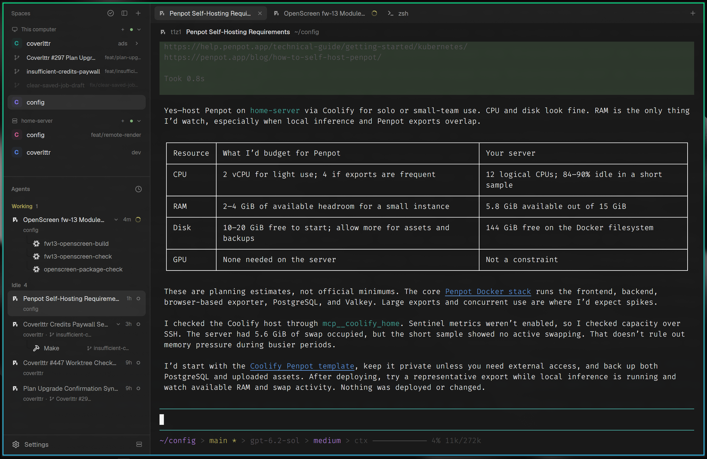

# Herdr T3 Worktrees



A [Herdr](https://herdr.dev/) desktop layout built around git worktrees and an attention inbox. Spaces show their linked worktrees nested underneath; an agents list shows two-line rows; a toggle swaps it for an Inbox of agents that still need you, with Working and Settled shelves. Terminals are framed cards with compact headers, and a top popup jumps between tabs.

## Install

Ask an agent inside the Herdr app:

```text
Read ~/.config/herdr-app/AGENTS.md, then add this layout: herdr.dev/layouts/enesbala5/herdr-t3-worktrees
```

You can also point the agent straight at this repo: <https://github.com/enesbala5/herdr-t3-worktrees>.

The agent reads every file before writing, copies the layout and its mods next to yours, leaves your own layout untouched, and you switch between them with `ctrl-shift-l`. Deleting the added files removes it.

## What you get

- **Spaces** (`spaces-with-worktrees`): spaces grouped by machine, with branch labels and status. A repo with linked worktrees has a chevron to reveal all of them; closed worktrees show only when dirty or when an agent is inside.
- **Agents** (`agents-list`): two-line rows — state glyph and session title, then program icon, agent name and workspace · worktree. `alt-1…9` focuses the Nth agent in the visible order.
- **Inbox** (`t3-inbox`): only agents that need attention, newest first, with Working and Settled shelves. `ctrl-shift-s` settles the focused agent; a new turn brings it back. The inbox follows the T3 "settle until there's news" idea.
- **Tabs and pane headers** (`t3-tabs`, `t3-pane`): pills with agent status, drag to reorder, wheel to cycle; headers with program, folder, status and split/zoom/close buttons on hover.
- **Picker** (`t3-picker`): a top popup, `ctrl-p` / `ctrl-alt-p`, filtering tabs and spaces with the ones that need you first.
- **New menu** (`t3-new-menu`) and **toasts** (`t3-toast`): a space search popup for new tabs, and flat toast content inside Herdr's overlay chrome.

The layout, brand bar and footer are `layout-controls`. Clicks and saved sizes stay in `layouts/.state/` and are not shipped here.

## Keys

`keys.json` in this repo is a **snippet to merge into your own key map**, never a replacement. Bindings to be aware of:

| Key | Action |
| --- | --- |
| `alt-1…9` | Focus agent N in the list |
| `ctrl-1…9` | Select primary space N (worktree rows are not numbered) |
| `ctrl-p`, `ctrl-alt-p` | Open the Go-to picker |
| `ctrl-shift-b` | Switch Lists ↔ Inbox |
| `ctrl-b` | Toggle the sidebar |
| `ctrl-shift-s` | Settle / un-settle the focused agent |
| `ctrl-\` | Show or hide the right shell pane |
| `ctrl-alt-up` / `ctrl-alt-down` | Scroll the terminal and its program history to either edge |

The `layout:herdr-t3-worktrees` section applies only while this exact layout file name is shown; `ctrl-1…9` intentionally overrides the usual `space.select` bindings in that layout.

## Layout of this repo

```text
.
├── README.md                 this file
├── RECIPE.md                 build brief: what to make, in Herdr's 6 sections
├── preview.png               screenshot used by the gallery (herdr-app shot)
├── keys.json                 key snippet to merge
├── layouts/
│   ├── herdr-t3-worktrees.json
│   └── herdr-t3-worktrees.svg  in-app settings thumbnail
└── mods/
    ├── agents-list/           agents list clone
    ├── layout-controls/       brand bar, footer, side pane, edge scrolling
    ├── spaces-with-worktrees/ spaces list clone
    ├── t3-inbox/              attention inbox
    ├── t3-new-menu/           new tab / new space popup
    ├── t3-pane/               pane header clone
    ├── t3-picker/             Go-to popup clone
    ├── t3-tabs/               tab bar clone
    └── t3-toast/              toast content clone
```

Every mod was given a name that cannot replace a shipped Herdr mod, including `t3-picker` and `t3-toast`. The layout root sets `"toast": "t3-toast"`; remove that field if you want Herdr's own toast.

## Requirements and notes

- Built and checked against the Herdr desktop app **0.1.13**. Clones record `cloned_from` versions 0.1.10 / 0.1.11 in their manifests. Run `herdr-app check mods/<name>` after changing any mod.
- `git` must be on PATH locally and on any remote machine whose worktrees you view: the Spaces and Agents mods run read-only `git status`, `rev-parse` and `worktree list`. `hc` is used for `machine ls --json` and to write the `settled=<ms>:<turn>` terminal label in the inbox.
- No `fetch` or network calls. State lives in the mods' own `localStorage` keys and a few shared keys (`agents.changed`, `agents.pins`, `space.colors`).
- Shipped mods used by path (`workspace-chrome` icons, `pane/close.svg`, `files`, `changes`, `workspace-status`, `menu`) are not bundled.
- The shipped `herdr.d.ts` and `gpui-kit.d.ts` in mod folders are editor aids; the app rewrites its own copies on start. `check-inbox.cjs` and `check-pane.cjs` are dev test harnesses, not runtime requirements.
- This repo has no license file; it is published as-is for the Herdr gallery.

## Relationship to `enesbala5/config`

This repo is added to [enesbala5/config](https://github.com/enesbala5/config) as a git submodule at `herdr-t3-worktrees/`. That config is the daily-driver setup: its home-manager module reads the desktop mods from this repo's `mods/` and symlinks the layout files from `layouts/`. A config rebuild pins the submodule revision; `git submodule update --remote herdr-t3-worktrees` advances it to the newest published revision.
